# Goku vs Cell

A Dragon Ball boss fight I made in plain JavaScript, with no engine and no build step. Pick a side and
fight the other one.

**[Play it in your browser](https://potatos-119.github.io/goku-vs-cell/)** (keyboard or gamepad, nothing to install).

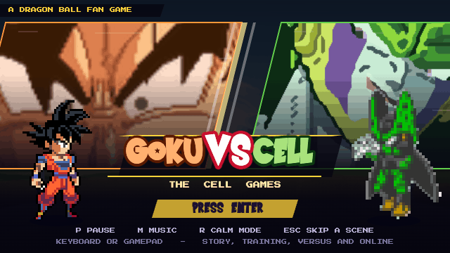

Play Goku and you're trying to stop Cell before he gets perfect. He goes Semi-Perfect at 2/3 health,
sends in three Cell Juniors at 1/3, then comes back as Perfect Cell for the last stretch. Play Cell and
it flips: you evolve yourself (T at full ki) and Goku is the boss, going Kaioken at 2/3 and Super Saiyan
at 1/3. Beat the last phase and it ends in one final beam clash.

## In action

| | |
|---|---|
| 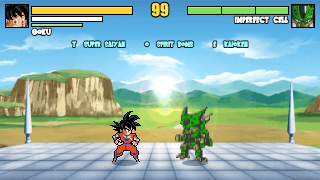 | 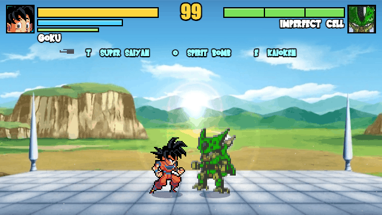 |
| Kaioken, then its finisher: the rush, a flip kick, and a Kamehameha up at them | T right after a hit: Super Saiyan in the middle of a combo |
| 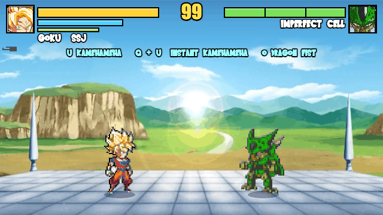 | 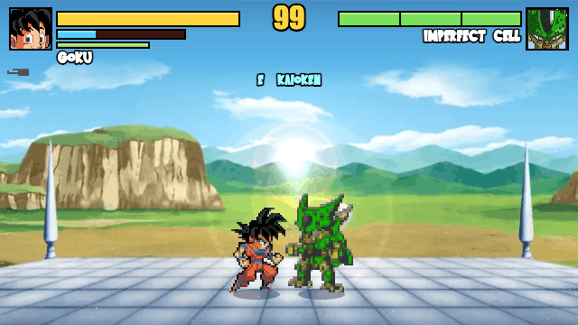 |
| Instant Kamehameha: a leap, Instant Transmission, and a point-blank beam | Dragon Rush (F, 15 ki): grab, three hits, launch, and chase them up |
| 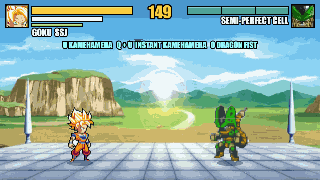 | 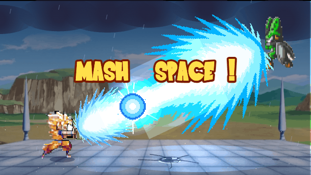 |
| Spirit Bomb from the air: land it and he turns Super Saiyan | The final clash: mash Space to win it |
| 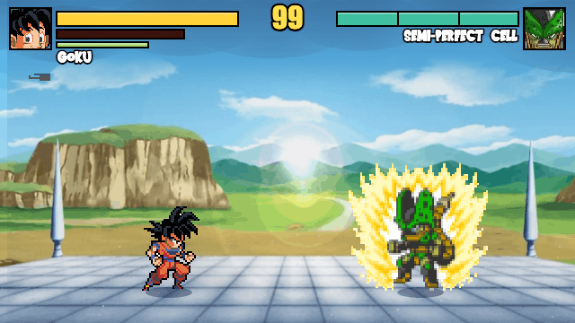 | 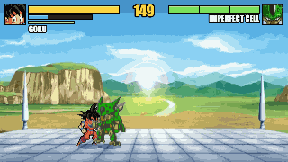 |
| Perfect Cell's reveal | Air combo: launcher, re-launch, dunk |
| 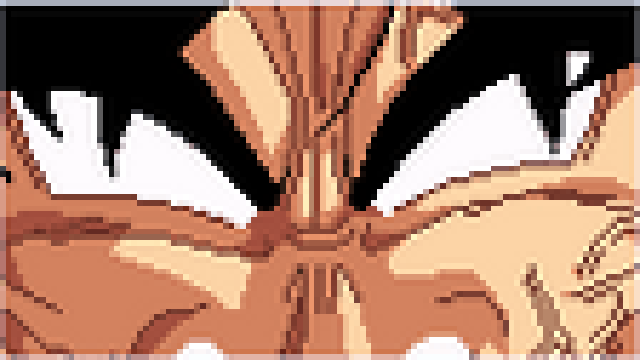 | 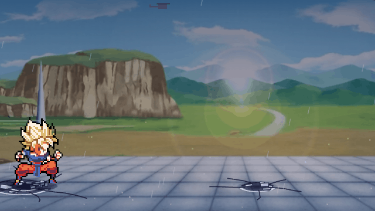 |
| The first time he turns Super Saiyan hurt: the scream, the gold, and the reveal | Lose the final clash and Goku gets up for one last Instant Kamehameha |

All recorded from the game.

## Forms

| Goku | |
|---|---|
| Base | Runs on foot. Kamehameha (U), Spirit Bomb (O at full ki). Throw it from the air and it turns him Super Saiyan if it lands |
| Kaioken (E, 25 ki) | The fastest form. Burns ki while it's on, two air dashes, O (50 ki) is its finisher: a rush, a kick that sends them up, and a Kamehameha aimed up at them |
| Super Saiyan (T at full ki, or T right after a hit lands to turn mid-combo) | Hits hardest. Instant Kamehameha in his full gi (Instant Transmission from the ground or the air), and O is the Dragon Fist in his full gi or a rush into a Kamehameha once it's torn |

| Cell | |
|---|---|
| Imperfect | His grab heals him the most |
| Semi-Perfect | His hits break a guard faster |
| Perfect | The quick one: two air dashes, Cell Juniors, Solar Kamehameha |

When Goku is down to 45% health his gi top gets torn off and he fights on in the blue undershirt.
Going Kaioken tears it too. The first time he turns Super Saiyan like that is the full transformation
scene again, ending on a still of him battered and gold. Healthy again (the Senzu Bean, or turning
Super Saiyan out of the Kaioken with his health up) he's back in his full gi.

More of what Goku can do:

- **Dragon Rush** (F, or J + K; 15 ki): a grab through a block, three hits and a launcher; W chases them up
- **Instant Kamehameha** (Super Saiyan in his full gi: Q then U, or U then Q): from the ring he leaps up,
  vanishes, and reappears behind them holding the beam; it's also how he finishes a won fight
- **Spirit Bomb** (O at full ki, base): from the ring he rises into the sky to gather it; thrown from the
  air, landing it turns him Super Saiyan
- **The J string** ends in a launcher: W right after chases them into the air

In training, H shows or hides the combo checklist.

The two O attacks above (Kaioken's, and Super Saiyan's with the gi torn) start with a dash. Block it,
jump it or vanish and nothing happens. If it lands, the rest plays out by itself.

## Running it

The game loads its sprite data with `fetch`, which browsers block on pages opened straight from disk, so
serve the folder:

```bash
python3 -m http.server 8766
```

Open http://localhost:8766 and press Enter.

## Controls

| Key | |
|---|---|
| A / D | Move (double-tap or Shift to dash) |
| W / Space | Jump |
| S | Block. Tap it right as a hit lands for a perfect block |
| J / K | Punch / kick, press again to chain |
| J + K or F | Grab (goes through a block) |
| L | Ki blast, hold it to charge |
| I | Charge ki |
| U | Kamehameha |
| E | Kaioken (Goku) / Cell Junior (Perfect Cell) |
| T | Super Saiyan / evolve |
| Q | Vanish behind them |
| O | Finisher at full ki |
| G / Y | Cell's Barrier / Special Beam Cannon |
| P | Pause: retry, move list, combo list, controls, options |
| M / R | Music / calm mode (less shake and flashing) |
| F2 | FPS counter (also in Options) |

A gamepad works too (Xbox or PlayStation): plug it in and the tips switch to its buttons. Every key and
button can be changed in OPTIONS > KEYS & BUTTONS, and it's saved. The full move list and every combo
are in the pause menu.

## Modes

Story is the boss fight. You get a score sheet and a grade when you win.

Training gives you a dummy you can set up and a checklist of combos to try. If the checklist is in
your way, hide it in TRAINING SETTINGS.

Versus is two people on one keyboard or on gamepads.

For Online, one of you creates a room and reads out the 4-letter code, and the other types it in. The
two browsers connect directly (WebRTC, through the free PeerJS service), so there's no server of mine
in the middle. Some school and office networks block that, and then it just won't connect.

There are three difficulties in Options. On Easy the boss hits for half, has less health, thinks
slower and throws shorter combos.

## Files

- `game/`: the game, one file per system (input, combat, boss AI, cutscenes, menus, rendering), loaded
  in order as plain scripts
- `data.js`: the frames for each move, what each form is like, the move list and the combo list
- `gfx.js`: the renderer. There's no canvas: the game is drawn as SVG, one element per shape, sprite or
  line of text
- `frames.js`: loads the sprite frames, already cut out and packed into one atlas in `assets/frames/`
- `sheets.js`: cuts those frames out of the sheets. Only the bake tool uses it
- `goku-forms.js` and `assets/sheets/goku-forms.png`: Goku's looks (base, torn gi, Kaioken, Super
  Saiyan), made by `tools/goku-forms.py`
- `audio.js`: music, sound effects and the sound slice table
- `net.js`: online play
- `stage.js`: the arena and the damage the fight does to it
- `tools/checks.js`: a check for each bug that was fixed. Paste it in the console and run `await runChecks()`
- `tools/fuzz.js`: plays random fights fast and looks for crashes and stuck states
- `tools/balance.js`: measures how hard the boss hits on each difficulty
- `tools/bake.html`: re-bakes the frames after a sheet changes
- `tools/bake-add.py`: bakes only the frames that are new, without a browser
- `tools/ssj-kame.py`, `tools/ssj-moves.py`: Super Saiyan's Kamehameha, Instant Transmission and full-gi
  transformation, cut from the sheets
- `tools/record-page.js`: films the game frame by frame from inside the page, for the README GIFs

## Changing the sprites

1. `python3 tools/goku-forms.py` rebuilds Goku's looks (needs pillow, numpy and scipy).
2. Open `tools/bake.html`, press Bake, then run `node tools/write-frames.js ~/Downloads/frames-bake.json`.
   To add only new frames cut by exact rectangles, without a browser: `python3 tools/bake-add.py`.

Super Saiyan comes from two sheets, both at their full size: `goku-ssj-first.png` (mrruben7's, with the
gi top torn) and `goku-super-saiyan.png` (PeculiarDoc's, in his full gi). Every frame is cut from them
as drawn; the tool lines each full-gi frame up with the same pose on the torn-gi sheet. His full-gi Kamehameha (the poses and the beam)
comes from a sharp strip of the sheet: `python3 tools/ssj-kame.py STRIP.png` scales its smaller poses
up 1.25x (Scale2x, so the edges stay sharp) into `assets/sheets/goku-ssj-kame.png`. His Instant
Transmission is cut from the full-gi sheet by `python3 tools/ssj-moves.py` into
`assets/sheets/goku-ssj-moves.png`.

## Credits

Dragon Ball and its characters belong to Akira Toriyama, Bird Studio and Toei Animation.

The Goku sprites are Ultimate LSW fan sheets: Goku by qsab101, omegasuper, xbae12 and tougarashi635,
Kaioken by kaval2003, Super Saiyan by mrruben7 (with qsab101, allenyael and AntomTheTimeTraveler) and Que, sheets put together by 2ruffles and PeculiarDoc.
The music, sound effects and cut-ins come from fan recordings and edits.

This is a fan project made for learning, not for sale.
