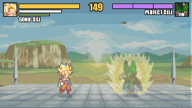
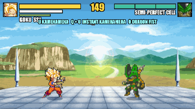
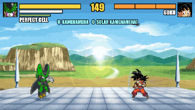

# Goku vs Cell

A Dragon Ball boss fight I made in plain JavaScript, with no engine and no build step. Pick a side and
fight the other one.

Play Goku and you're trying to stop Cell before he gets perfect. He goes Semi-Perfect at 2/3 health,
sends in three Cell Juniors at 1/3, then comes back as Perfect Cell for the last stretch. Play Cell and
it flips: you evolve yourself (T at full ki) and Goku is the boss, going Super Saiyan at 2/3 and all out
at 1/3.

The boss gets meaner every phase. It punishes whiffs, charging and broken guards, vanishes behind you
from phase two, answers beams with its own, and Super Dashes through ki blast spam. Both bosses use the
same named combos you can (Sky Chase, Meteor Smash, Wall Splat, Vanish Strike and the rest), and the
name pops up on their side of the screen when they land one on you.

## In action

| | |
|---|---|
|  |  |
| The final clash: mash Space to win it | Super Saiyan, timed to the music |
|  |  |
| Perfect Cell's reveal | Air combo: launcher, re-launch, dunk |
|  |  |
| Beam clash | Spirit Bomb |
|  |  |
| Instant Kamehameha | Special Beam Cannon |

All recorded from the game.

## Running it

The game loads its sprite data with `fetch`, which browsers block on pages opened straight from disk, so
serve the folder:

```bash
python3 -m http.server 8766
```

Open http://localhost:8766 and press Enter.

## Controls

| Key | |
|---|---|
| A / D | Move (double-tap or Shift to dash) |
| W / Space | Jump |
| S | Block. Tap it right as a hit lands for a perfect block |
| J / K | Punch / kick, press again to chain |
| J + K or F | Grab (goes through a block) |
| L | Ki blast, hold it to charge |
| I | Charge ki |
| T | Super Saiyan / evolve |
| Q | Vanish behind them |
| U | Kamehameha |
| O | Finisher at full ki |
| P | Pause: move list, combo list, controls, options |
| M / R | Music / calm mode (less shake and flashing) |
| F2 | FPS counter (also in Options) |

A gamepad works too. The full move list and every combo are in the pause menu, and training mode
(pick it after choosing a fighter) has a dummy you can set up and a checklist of combos to try.

Options cover difficulty, volume, calm mode and the arena, and they're saved between visits.

## Files

- `game/`: the game, one file per system (input, combat, boss AI, cutscenes, menus, rendering), loaded
  in order as plain scripts
- `data.js`: the frames for each move, the move list and the combo list
- `gfx.js`: the renderer. There's no canvas: the game is drawn as SVG, one element per shape, sprite or
  line of text, and elements are reused from frame to frame so only what changed gets touched
- `frames.js`: loads the sprite frames, already cut out and packed into one atlas in `assets/frames/`
- `sheets.js`: cuts those frames out of the original sheets. Only the bake tool uses it
- `audio.js`: music, sound effects and the sound slice table
- `stage.js`: the arena and the damage the fight does to it
- `tools/balance.js`: plays the boss at high speed and measures how hard it hits per phase
- `tools/bake.html`: re-bakes the frames after a sheet changes (`tools/atlas.html` shows the result)
- `tools/scene.js`: freezes the game on a fixed scene, for comparing screenshots between versions
- `tools/frames.html`, `tools/sounds.html`: browse sheet frames and sound slices

The boss tuning lives in `BOSS_FLOW` and `BOSS_COMBO_BUDGET` in `game/boss-ai.js`.

## Credits

Dragon Ball and its characters belong to Akira Toriyama, Bird Studio and Toei Animation. The sprites,
music, sound effects and cut-ins come from fan sprite sheets and recordings. This is a fan project made
for learning, not for sale.
