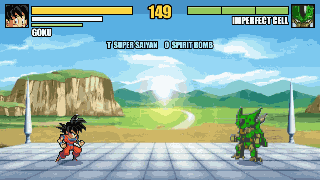
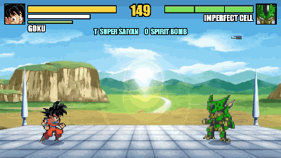
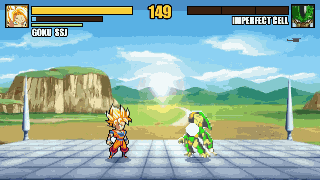

# Goku vs Cell

A Dragon Ball boss fight I made in plain JavaScript and canvas, without an engine or a build step. You
pick a side on the select screen and fight the other one.

If you play Goku, you're trying to stop Cell before he gets perfect. He starts out Imperfect and turns
Semi-Perfect at 2/3 health. At 1/3 he sends in the Cell Juniors, three of them, one after another, while
he stands at the back of the ring with his arms folded. Beat all three and he comes back and goes Perfect
for the last stretch.

If you play Cell, it's the other way around. You fill your ki and press T to evolve yourself, and Goku is
the boss. He goes Super Saiyan at 2/3 health and all out at 1/3, Dragon Fist and all.

Boss Goku fights with everything you can do as him. He chases his launchers into the air and finishes
the air string with a Meteor Smash, or with a Kamehameha down at you once he's a Super Saiyan. He ends
ground strings with the wall-bounce slash when you're near the edge, a launcher, a ki blast or a
Kamehameha, and he hits back when he blocks one of your attacks. He jumps in, Instant Transmissions from
the start, fires air Kamehamehas from a jump and throws ki barrages. Each phase he does all of it more
often, and he uses the Instant Kamehameha from his Super Saiyan phase on. The numbers are `GOKU_BOSS`,
`GOKU_CHASE`, `GOKU_CANCEL` and `GOKU_PUNISH` in `game.js`.

The boss gets meaner as it goes. From phase two it can vanish out of your attacks and hit you from behind.
It also watches what you do: charge in front of it, whiff, or let your guard break and it punishes you.
It blocks or dodges beams, or fires its own back. And spamming ki blasts won't work. It blocks them, jumps
over them, or Super Dashes straight through them and makes you pay, and the more you spam the more often
it does that.

## In action

| | |
|---|---|
|  |  |
| **The final clash**: beat Perfect Cell and he fires a Solar Kamehameha from the sky. Mash Space | **Super Saiyan**: the eyes close-up, then gold right on the music's hit |
|  |  |
| **Perfect Cell**: his theme, his reveal, and he appears on the drop | **Air combo**: launcher, F to re-launch, S + J to dunk him off the ring |
|  |  |
| **Charged ki blast**: hold L, let go | **Beam clash**: a counter beam (U) against the Solar Kamehameha, then mash Space |
|  |  |
| **Spirit Bomb**: power down from Super Saiyan (T), then O, gathered up in the sky | **Instant Kamehameha**: Q then U at full ki |
|  |  |
| **Special Beam Cannon**: Cell's Y, straight through a guard | **Ki barrage**: toward + L |
|  | |
| **Victory**: Goku powers down and sits down to rest | |

The GIFs are recorded from the game itself.

## How to run it

The game reads sprite pixels off a canvas, and browsers don't allow that for a page opened straight from
disk, so you have to serve the folder:

```bash
python3 -m http.server 8766
```

Then open http://localhost:8766 and press Enter.

## Fighting

The basic chains are J J J J or K K K for Goku, and J J K or K K for Cell. The last hit of a chain
launches them. Press W right after and you jump up after them, then J J J in the air does two hits and a
spike that slams them into the ring and bounces them back up.

The spike is also its own move, the dunk: S + J (or K) in the air, any time, even straight out of a jump.
It reaches down at whoever's under you, so it works on someone standing too. They hit the ring and bounce
back up, once per combo ("GROUND BOUNCE!"), and you get one more hit off the bounce (the DUNK SHOT combo).
Boss Goku dunks you out of his air combos as well.

F in the air is the re-launch: a rising kick (Cell's is a tail strike) that sends a juggled enemy flying
back up, carries you up with them and gives you your air dash back. It works once per combo and buys the
juggle a little room, so the string can keep going (the RELAUNCH combo: air hit, F, J). A second F in the
same combo is just an air hit. Boss Goku uses it too.

Hold L to charge a ki attack instead of tapping it. Goku holds both hands full of ki and the ball grows; let
go and it flies, bigger, slower and harder the longer you held: up to 20 damage at a full second, twice
the size, and it knocks down. Cell holds his Death Beam at his fingertip instead: up to 24 damage, and it
knocks down from halfway. A tap is still the normal shot. It costs 8 ki to start and up to 12 more while it
charges, and you can't move while you hold it, so the boss will come for you (it also charges its own
from a distance now and then).

Once a hit lands you can cancel the rest of the move into a ki blast (L), a beam (U), a vanish (Q) or a
dash. In the air it's the same idea: after an air hit, double-tap toward them to dash in (it homes in on
them) and keep going, or press U to fire the Kamehameha right
out of the combo. A beam carries a flying enemy along and blasts them away at the end. The longest route
I've found is J J J J, W, J J, dash, J J, U.

Ki blasts work in combos too. L works in the air, and if the blast hits you can cancel it like a punch:
J rushes in after it, or go into a dash, Q, U or another L. So on the ground something like J J, L, J,
J J, and in the air J J, L, double-tap, J J, U.

A few more things:

- J + K together (or F) is a grab, Dragon Rush for Goku and Absorb for Cell. It goes through a block and
  launches them, so W, J J J follows. It's slow, though, and hitting them first beats it. The boss will do
  it to you if you sit behind your guard too long.
- Hit someone while their own attack, ki blast or beam is still starting up and you get a counter hit:
  25% more damage and a longer stun.
- The heavy slash (toward + K) bounces them off the edge of the screen for a follow-up.
- Juggles are capped and long combos hit softer, so nothing loops forever.
- At full ki you get a finisher. SSJ Goku's is the Instant Kamehameha: vanish (Q) and press U while he's gone, or start a Kamehameha (U)
  and vanish (Q) while it charges. U on its own is always the regular Kamehameha, even at full ki.
  Perfect Cell's is the Solar Kamehameha (O on the ground, in the air or right after a hit): he flares his
  aura, vanishes, shows up high above and fires a huge Kamehameha down into the ring.
- Base Goku's finisher is the Spirit Bomb (O at full ki, on the ground or in the air). He rises into the
  sky and it gathers above his raised arms for a second and a half; he's open while it does, and a hit makes him lose it. Then he throws it: slow and
  huge, it goes through a guard but can be dodged, and it bursts for 45 (15 if it lands near them).
  It also finishes a combo: land a hit (on the ground or in the air) at full ki and press O. The hit
  leaves them dazed, the bomb gathers in 0.6 seconds, flies faster, and still crushes them if they're
  already down. Named combos: SPIRIT BOMB FINISH and SKY SPIRIT BOMB (launcher, W, J, then O).
  As a Super Saiyan, in the air at full ki, there are two ways to throw it. O powers him down right
  there in the sky (the gold fades back to black), then he raises his arms: slower, and a hit while the
  gold fades stops it, but the bomb is bigger and hits for 25% more. S + O keeps the gold hair and goes
  straight into it, a normal-size bomb with golden energy streaming in. Both work after an air hit too.
- You can answer a finisher. Before the beam fires, a ring closes in around you: U fires a counter beam
  (30 ki) into a beam clash, Q vanishes (15 ki), S blocks. Vanish when the ring turns gold and it's a
  clean dodge that leaves them open; too early and the beam grazes you. A block takes half and breaks your
  guard. Do nothing and you take all of it. The boss answers yours the same way.
- When two Kamehamehas meet you get a beam clash: mash Space (J and U count too, and A on a gamepad) to
  push the ball of energy back at them.
  You can force one: while their Kamehameha charges or fires, press U (30 ki), even out of a block or
  while it's burning you.
- Blocking depends on the hit. A light one drives you into a crouch, a heavy one (or a launcher) knocks
  you back off your feet, still guarding. Hold S in the air to block there too (arms crossed); a hit pushes
  you away and you land guarding.
- The last stand: beat the final boss and it isn't over yet. Cell flies up and charges a Solar Kamehameha
  to take the planet with him, and Goku answers with a Kamehameha from the ring. It's the hardest beam
  clash in the game. In Goku's story, win it and Cell is wiped out; lose it and Goku gets up for one last
  Instant Kamehameha, point-blank... and Cell regenerates and finishes him. Cell's story is the same scene
  from his side.
- Goku powers down when it's over: back to his normal hair before his victory pose, and if he's knocked
  out as a Super Saiyan, the gold flickers out of his hair as he lies there.
- Perfect Cell regenerates fully when he completes himself, with a bigger health bar than before. Beat the
  Cell Juniors and Krillin throws you a Senzu Bean: full health, full ki and a bigger health bar (130) for
  the last fight.
- The combo counter shows hits and damage. Land a named combo and you get its name on screen and +8 ki.

Cell has a few tools Goku doesn't. His grab is Absorb, which heals him and drains your ki. G is his
Barrier, a burst that throws you off and works even while he's getting hit (30 ki). As Perfect Cell, E
calls in a Cell Junior that flies at you and launches you (35 ki, also after a landed hit). Holding I
heals him a little while he charges. The boss Cell uses all of these on you too.

P pauses. The pause menu has the full move list, a combo list (the ones you've landed get ticked) and
the controls. There's also a training mode, which you can pick after choosing a fighter. The dummy can't
be KO'd and a checklist shows every combo with a hint for the next one to try. TRAINING SETTINGS in the
pause menu sets what the dummy does (stands still, blocks everything, jumps, walks up and throws single
hits for you to practise blocking and perfect blocks, or fights back like the boss) and what refills: its
health, yours, and your ki (refills, no refill, or always full). They're saved for next time.

## Controls

| Key | What it does |
|---|---|
| A / D | Move |
| W / Space | Jump. In a beam clash, mash Space to push |
| S | Block (hold it in the air for an air block). You turn to face the attacker and a ki barrier flares on each blocked hit. When the boss vanishes behind you, a red ! flashes just before it attacks, so you can still block it |
| Tap S as a hit lands | Perfect block: no damage, +25 ki, and punches leave them dizzy |
| Double-tap A / D (or Shift) | Dash forward or hop back, once per jump in the air |
| J / K | Punch / kick, press again to chain |
| Toward + J | Rushing punch |
| Toward + K | Heavy slash (knockdown, wall bounce) |
| J + K / F | Grab: Dragon Rush (Goku) or Absorb (Cell) |
| Hold L | Charge it up: a bigger ki blast (Goku) or the Death Beam (Cell), stronger the longer you hold |
| F in the air | Re-launch a juggled enemy, once per combo |
| L | Ki blast (Goku) / finger beam (Cell). Toward + L is a barrage: Goku's four-blast ki barrage (15 ki), Cell's finger barrage (Semi-Perfect and up) |
| S + J in the air | Dunk: slam them into the ring and bounce them back up |
| Hold I | Charge ki |
| T | At full ki: Super Saiyan (Goku) or evolve to the next form (Cell) |
| Q | Vanish to their other side, in the air too. Press it again before they turn and you're back in front of them |
| U | Kamehameha (SSJ Goku or Cell in any form, 50 ki; from the air it angles down). Cell in any form: toward + U is the Death Beam (20 ki), and so is U when he has under 50 ki. Against their Kamehameha: counter beam (30 ki) |
| Y | Cell's Special Beam Cannon (35 ki, any form): a fast drilling beam that goes through a guard and through ki blasts |
| Q then U, or U then Q, at full ki | Instant Kamehameha (SSJ Goku), on the ground or in the air |
| T as Super Saiyan | Goku powers back down to base and keeps his ki (going back up is quick after that) |
| O | At full ki: Spirit Bomb (base Goku) / Dragon Fist (SSJ Goku) / Solar Kamehameha (Perfect Cell) |
| G | Cell's Barrier (30 ki) |
| E | Perfect Cell calls a Cell Junior (35 ki) |
| P | Pause |
| M | Music on/off |
| R | Calm mode: a lot less screen shake and flashing |
| Esc | Skip the intro, or go back to character select after a fight |

The keys are read by position, so this layout also works on AZERTY and other keyboards. A gamepad works
too: A jump, X punch, Y kick (X + Y grab), B ki blast, LB block, RB dash, LT charge, RT beam, Back
vanish, Start pause, L3 transform, R3 ultimate, and the stick or d-pad to move. If you press something a
moment before you're able to act (while landing, say), the game remembers it, so inputs don't get eaten.

Blocking uses the green stamina bar under your ki bar. Holding block drains it slowly and every hit you
block takes a chunk. If it hits zero your guard breaks, the hit lands, and you can't block again until it
refills. Perfect blocks give some back.

## Stage, music and options

The arena is the Cell Games ring. `assets/img/arena.jpg` is the art upscaled 2x with the sky extended so
it fills a 16:9 screen. The older painting, `assets/img/cell-games.webp`, is still there as the CLASSIC
arena in the options. On top of it there's dust, a news helicopter, rocks that float up when someone
powers up, and cracks wherever someone gets slammed.

The fight wrecks the place as it goes, all drawn in code (no extra art):
- a Kamehameha low over the ring tears it up underneath and leaves a burnt trench that glows, then cools
- a beam or a Special Beam Cannon that flies off the screen hits the mountains: a flash, a fireball on the
  horizon and a mushroom of smoke (ki blasts make a small puff)
- craters throw up rolling dust, and a wall bounce bursts rock and dust off the edge of the arena
- a beam clash cracks the ring under the meeting point and keeps tearing it up while they push
- powering up blows wind streaks out along the ring, and the sky darkens while the Spirit Bomb gathers
- the ring keeps its last 24 scars, so a long fight leaves it in pieces

On big or retina screens the game draws at twice
the resolution so everything stays sharp. The camera stays still during the fight and only pushes in for
cinematics.

Music:

- `assets/audio/bg-theme.mp3` loops during fights. It's a 4-minute cut of the background OST.
- `assets/audio/perfect-cell.mp3` plays when Cell becomes Perfect (as the boss or as you). It's 83 seconds
  of a Perfect Cell theme cover (22.8s to 106.1s of the track), cut so its big hit lands 6.1 seconds in
  (`PERFECT_HIT` in `game.js`): his aura flares, the close-up of his reveal plays, and he appears as Perfect
  Cell right on the hit. The theme carries on through the fight, then fades back into the fight music.
- `assets/audio/ssj-transform.mp3` plays when Goku goes Super Saiyan. It's 15 seconds of Blue Saiyan
  (57.4s to 72.5s of the track), and the build-up hits 5.05 seconds in. The transformation is a short
  cinematic timed to that hit, so his hair turns gold right on it (`SSJ_PEAK` in `game.js`). After that
  the fight theme comes back.

Kamehameha sound:

- `assets/audio/kamehameha.mp3` is the whole move: the chant builds from 0.85 to 6.95 seconds, then
  "HA!" and the beam from 7.05 seconds. Goku and Cell both use it (Cell's a little lower, and the Solar
  Kamehameha lower still). The charge plays the chant's last stretch so it ends right as the beam fires,
  and the blast holds as long as the beam does, looping its loud middle through a long beam clash. A
  quick counter beam skips the chant. The timings are in `KAME` in `audio.js`. If the file can't load,
  the synthesised charge and beam sounds play alone.

Sound effects: the hits, ki blasts, knockouts, the charge and the Spirit Bomb are recordings, with the
synthesised versions as a fallback while they load:

- `assets/audio/dbz-fight-pack.mp3`: 40 punches, kicks, whooshes and impacts in one file
- `assets/audio/ki-blasts.mp3`: single ki blasts (L) and a rapid volley (the barrage), cut to the 8 seconds the game uses
- `assets/audio/ki-charge.mp3`: the aura while charging ki (I), looped
- `assets/audio/knockout.mp3`: six knockout hits for the final blow
- `assets/audio/spirit-bomb.mp3`: the Spirit Bomb gathering, then thrown

Several files hold many sounds, so `SLICES` in `audio.js` lists which part of which file plays for each
event. Open `tools/sounds.html` to hear every slice on its own and retune the list.

Cut-ins: two anime close-ups in `assets/cutins/`. `goku-ssj-eyes.gif` (his eyes narrowing) plays in the
music's build-up just before his hair turns gold, and `cell-perfect-reveal.gif` (his hand pulling away from
his new face) plays when Cell becomes Perfect, as the boss or as you (Enter skips it). The game plays them
from the `.png` frame sheets next to them, which hold each distinct frame once; the timing is the GIF's.

To change the music, swap either file. The paths are in `TRACKS` in `audio.js`. There's also a
`VOICE_CLIPS` table there if you want to add recorded voice lines.

The options (from the pause menu, or the menu after you pick a fighter) cover music and sound volume,
music on/off, calm mode and the arena. They're saved between visits.

## Files

- `game.js`: the game loop, fighters, boss AI, beams, cutscenes and HUD
- `data.js`: which sprite-sheet frames make up each move, plus the move and combo lists
- `sheets.js`: cuts the sheets into frames and removes the white background
- `audio.js`: the music player, the recorded and generated sound effects, jingles, and the voice clip hook
- `stage.js`: the arena and its live effects
- `assets/sheets/goku.png`: Goku's main sheet (base, Super Saiyan and the Super Saiyan 3 Dragon Fist). The
  game uses every real frame on it, including the Super Saiyan standing pose (10.9), the whole ki blast
  (9.0 to 9.4), all four guard frames (3.0 to 3.3) and the dash skid (0.0, 0.1). The charge opens on the
  small aura (10.2) before the big flames loop, and the Super Saiyan charge is the same frames with the
  hair and aura turned gold
- `assets/sheets/goku1-source.png`: the bigger Goku sheet. Its rows are too irregular to cut up
  automatically, so the frames the game uses are cut from it by exact rectangles (`G2(...)` in `data.js`):
  the Spirit Bomb (all six of Goku's frames, the bomb and its explosion rings), the victory animation, and
  the HUD icon
- `assets/sheets/goku-ssj2.png`: a second Super Saiyan Goku sheet, by a different artist, on a dark
  background and drawn smaller. The game takes Super Saiyan Goku's movement and charge-up from it: his
  walk cycle, his stance for stepping back, his dash, his jump (crouch, spring, top, fall, landing) and the
  gold aura flickering round him as he charges. Those frames are cut by exact rectangles (`SJ(...)` in
  `data.js`) and drawn at 1.25x so he stays the same size; his attacks stay on the main sheet.
- `assets/cutins/`: the two anime cut-ins (the original GIFs and the frame sheets the game draws)
- `tools/sounds.html`: plays every recorded sound slice
- `assets/gifs/`: the GIFs at the top of this README, recorded from the game
- `assets/img/goku-face.png`: base Goku's HUD and dialogue icon, cut from the title of `goku1-source.png`
- `assets/sheets/cell.png`: Cell's three forms plus the Cell Juniors (rows 17-21). `cell-faces.png` has his portraits
- `tools/frames.html?sheet=goku`: shows every frame of a sheet with its id. `?sheet=goku2` shows the
  rectangles the game cuts from `goku1-source.png`
